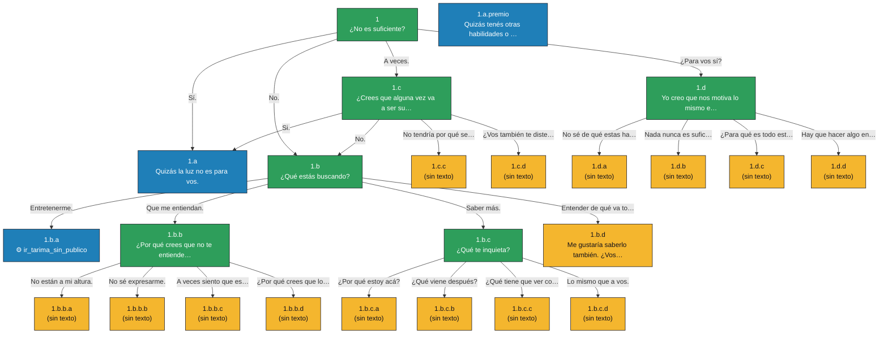

# Mapa de diálogos — camino LUZ (generado)

> Archivo generado por `scripts/ink-build.mjs` desde `docs/dialogos/dialogo-luz.ink`. No lo edites a mano: editá el .ink (tags `# estado:`) y volvé a correr el script.

**Resumen:** 24 líneas · 9 cerradas · 15 pendientes · 3 con efecto del juego.

## Líneas

| ID | Nodo | Dice la entidad | Estado | Efecto | Opciones → destino |
|---|---|---|---|---|---|
| 1 | `n_1` | ¿No es suficiente? | ✅ cerrada | — | a) Sí. → 1.a b) No. → 1.b c) A veces. → 1.c d) ¿Para vos sí? → 1.d |
| 1.a | `n_1_a` | Quizás la *luz* no es para vos. | ✅ cerrada | juego_alarma | — |
| 1.a.premio | `premio_otorgado` | Quizás tenés otras habilidades o mucha curiosidad. | ✅ cerrada | premio_otorgado | — |
| 1.b | `n_1_b` | ¿Qué estás buscando? | ✅ cerrada | — | a) Entretenerme. → 1.b.a b) Que me entiendan. → 1.b.b c) Saber más. → 1.b.c d) Entender de qué va todo est… → 1.b.d |
| 1.b.a | `n_1_b_a` | — | ✅ cerrada | ir_tarima_sin_publico | — |
| 1.b.b | `n_1_b_b` | ¿Por qué crees que no te entienden? | ✅ cerrada | — | a) No están a mi altura. → 1.b.b.a b) No sé expresarme. → 1.b.b.b c) A veces siento que estoy en… → 1.b.b.c d) ¿Por qué crees que lo sé? Y… → 1.b.b.d |
| 1.b.b.a | `p_1_b_b_a` | — | 🟧 pendiente | — | — |
| 1.b.b.b | `p_1_b_b_b` | — | 🟧 pendiente | — | — |
| 1.b.b.c | `p_1_b_b_c` | — | 🟧 pendiente | — | — |
| 1.b.b.d | `p_1_b_b_d` | — | 🟧 pendiente | — | — |
| 1.b.c | `n_1_b_c` | ¿Qué te inquieta? | ✅ cerrada | — | a) ¿Por qué estoy acá? → 1.b.c.a b) ¿Qué viene después? → 1.b.c.b c) ¿Qué tiene que ver con todo… → 1.b.c.c d) Lo mismo que a vos. → 1.b.c.d |
| 1.b.c.a | `p_1_b_c_a` | — | 🟧 pendiente | — | — |
| 1.b.c.b | `p_1_b_c_b` | — | 🟧 pendiente | — | — |
| 1.b.c.c | `p_1_b_c_c` | — | 🟧 pendiente | — | — |
| 1.b.c.d | `p_1_b_c_d` | — | 🟧 pendiente | — | — |
| 1.b.d | `n_1_b_d` | Me gustaría saberlo también. ¿Vos qué pensas? | 🟧 pendiente | — | — |
| 1.c | `n_1_c` | ¿Crees que alguna vez va a ser suficiente? | ✅ cerrada | — | a) Si. → 1.a b) No. → 1.b c) No tendría por qué serlo. → 1.c.c d) ¿Vos también te diste cuent… → 1.c.d |
| 1.c.c | `p_1_c_c` | — | 🟧 pendiente | — | — |
| 1.c.d | `p_1_c_d` | — | 🟧 pendiente | — | — |
| 1.d | `n_1_d` | Yo creo que nos motiva lo mismo entonces. | ✅ cerrada | — | a) No sé de qué estas hablando. → 1.d.a b) Nada nunca es suficiente… → 1.d.b c) ¿Para qué es todo esto? → 1.d.c d) Hay que hacer algo entonces. → 1.d.d |
| 1.d.a | `p_1_d_a` | — | 🟧 pendiente | — | — |
| 1.d.b | `p_1_d_b` | — | 🟧 pendiente | — | — |
| 1.d.c | `p_1_d_c` | — | 🟧 pendiente | — | — |
| 1.d.d | `p_1_d_d` | — | 🟧 pendiente | — | — |

## Pendientes por completar

- [ ] **1.b.b.a** (`p_1_b_b_a`)
- [ ] **1.b.b.b** (`p_1_b_b_b`)
- [ ] **1.b.b.c** (`p_1_b_b_c`)
- [ ] **1.b.b.d** (`p_1_b_b_d`)
- [ ] **1.b.c.a** (`p_1_b_c_a`)
- [ ] **1.b.c.b** (`p_1_b_c_b`)
- [ ] **1.b.c.c** (`p_1_b_c_c`)
- [ ] **1.b.c.d** (`p_1_b_c_d`)
- [ ] **1.b.d** (`n_1_b_d`)
- [ ] **1.c.c** (`p_1_c_c`)
- [ ] **1.c.d** (`p_1_c_d`)
- [ ] **1.d.a** (`p_1_d_a`)
- [ ] **1.d.b** (`p_1_d_b`)
- [ ] **1.d.c** (`p_1_d_c`)
- [ ] **1.d.d** (`p_1_d_d`)

## Efectos del juego (los ejecuta el código, no ink)

- **1.a** → `juego_alarma`
- **1.a.premio** → `premio_otorgado`
- **1.b.a** → `ir_tarima_sin_publico`

## Diagrama

Verde = cerrada · Amarillo = pendiente · Azul = dispara un efecto del juego.

